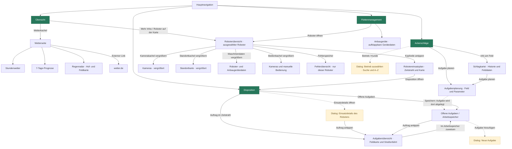

# Navigation des ROBOplan-Prototyps

Stand: 4. November 2026. Durchgezogene Pfeile zeigen Seiten und Unteransichten; gestrichelte Pfeile öffnen Dialoge. Die vier Hauptbereiche sind über die obere Navigation erreichbar. Rückwege sind zur Lesbarkeit überwiegend ausgelassen.

## Navigation innerhalb einer Seite

- **Übersicht:** Ein Robotereintrag fokussiert die Karte und aktualisiert den Wetterbezug. Rot/Orange/Grün filtern die Liste; sie öffnen keine Unterseite.
- **Roboterübersicht:** Die vier Kacheln sind Unteransichten derselben Roboterseite. „Zurück zur Roboterübersicht“ schließt die Vergrößerung. Manuelle Bedienung ist nur im Pausenmodus freigegeben.
- **Robotereinsatzplan:** Ein Zeitstrahleintrag markiert das zugehörige Feld auf der Karte; er öffnet keine weitere Seite.
- **Ackerschläge:** Die Betriebsauswahl ändert nur den angezeigten Namen. Die Aufgabenplanung legt beim Speichern eine Aufgabe im Arbeitsspeicher ab und bleibt geöffnet; der gestrichelte Pfeil dorthin bezeichnet daher einen Datenfluss.
- **Aufgabenübersicht:** „Zurück“ führt zur aufrufenden Ansicht; kam der Aufruf aus den Einsatzdetails, öffnet sich dieser Dialog wieder.
- **Fehlerübersicht:** Der Rückweg führt zum zugehörigen Roboter.

## Seitenadressen

| Seite | Adresse innerhalb von `app.html` |
| --- | --- |
| Übersicht | `#home` |
| Ackerschläge | `#ackerschlagskarte` |
| Flottenmanagement | `#roboterverwaltung` |
| Disposition | `#auftragsverwaltung` |
| Roboterübersicht | `#roboter-ID` |
| Robotereinsatzplan | `#roboter-plan-ID` |
| Wetter | `#wetter` |
| Fehlerübersicht | `#fehler` |
| Offene Aufgaben | `#arbeitsspeicher` |
| Aufgabenübersicht | `#aufgabe-ID` |

`ID` steht für die jeweilige Roboter- oder Aufgaben-ID. Schlagkartei, Aufgabenplanung, vergrößerte Kacheln und Dialoge haben keine eigene Seitenadresse.
